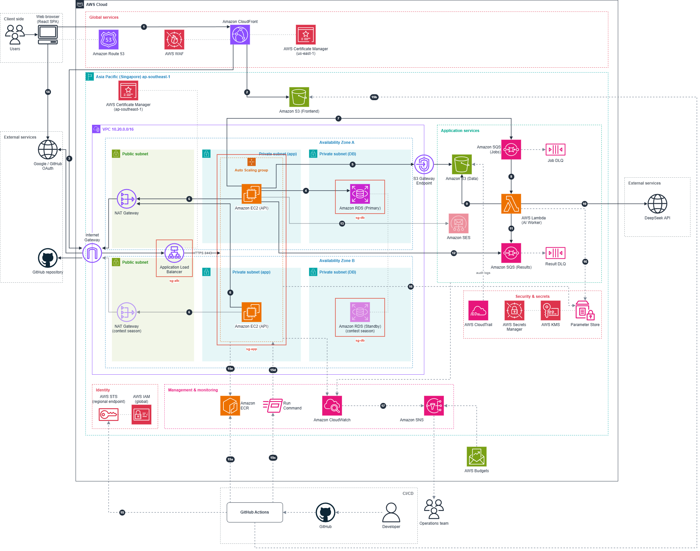

# SEAL Hackathon System

Nền tảng tổ chức và chấm thi hackathon. Hệ thống quản lý toàn bộ vòng đời một event: mở đăng ký, lập đội, phân track, nộp bài, chấm điểm, công bố kết quả. Giám khảo có thể nhờ AI phân tích mã nguồn GitHub của bài nộp để tham khảo trước khi chấm.

Hệ thống chạy trên AWS (region Singapore `ap-southeast-1`), deploy tự động bằng GitHub Actions và hạ tầng viết bằng CloudFormation.

## Mục lục

- [Chức năng](#chức-năng)
- [Thành phần và công nghệ](#thành-phần-và-công-nghệ)
- [Cấu trúc thư mục](#cấu-trúc-thư-mục)
- [Kiến trúc AWS v3](#kiến-trúc-aws-v3)
- [Hạ tầng dưới dạng code](#hạ-tầng-dưới-dạng-code)
- [CI/CD](#cicd)
- [Database và migration](#database-và-migration)
- [Chạy local](#chạy-local)
- [Tài liệu liên quan](#tài-liệu-liên-quan)

## Chức năng

| Vai trò | Làm được gì |
|---|---|
| `SYSTEM_ADMIN` | Quản lý tài khoản, cấp quyền, template tiêu chí chấm, xem system log |
| `EVENT_COORDINATOR` | Tạo và điều hành event: track, đề bài, vòng thi, timer, phân công giám khảo và mentor, duyệt đội, công bố kết quả |
| `JUDGE` | Chấm bài nộp theo tiêu chí của vòng; tạo **AI job** để nhận nhận xét tham khảo về repo |
| `MENTOR` | Hỗ trợ các đội trong track được phân công |
| `PARTICIPANT` | Đăng ký, lập hoặc tham gia đội, nộp bài (repo GitHub, demo, slide), xem kết quả |

Vòng đời event: **Draft → Open → Setup → Contest → Scoring & Results → Completed** (hoặc **Cancelled**).

Đăng nhập bằng email/mật khẩu hoặc OAuth Google/GitHub. Phiên dùng JWT trong cookie, có CSRF.

**AI job** chỉ mang tính tham khảo, không ghi điểm chính thức. Backend tải mã nguồn repo tại một commit cố định, đóng gói cùng rubric lên S3 và đưa job vào SQS. Lambda gọi model, ghi kết quả về S3, rồi backend nhận kết quả qua hàng đợi thứ hai. Đặc tả nằm ở [contract AI job](docs/contracts/ai-job-v1/CURRENT.md).

## Thành phần và công nghệ

| Thành phần | Thư mục | Công nghệ |
|---|---|---|
| Backend API | [`back-end/src/seal-api`](back-end/src/seal-api) | Java 21, Spring Boot 4, Spring Security, JPA/Hibernate, Flyway, MySQL 8.4 |
| Frontend | [`front-end/src/seal-web`](front-end/src/seal-web) | React 18, TypeScript, Vite, Vitest, Playwright |
| AI worker | [`ai-worker`](ai-worker) | Python, AWS Lambda, DeepSeek API ([README](ai-worker/README.md)) |
| Hạ tầng | [`infra`](infra) | CloudFormation, nginx/Caddy, IAM policy |
| CI/CD | [`.github/workflows`](.github/workflows) | GitHub Actions, OIDC, ECR, SSM Run Command |

## Cấu trúc thư mục

```text
.
├── back-end/
│   ├── src/seal-api/          # Spring Boot API (package com.seal.hackathon)
│   ├── Postman/               # Collection gọi thử API
│   └── AI logs/               # Nhật ký các phiên phát triển trước
├── front-end/src/seal-web/    # React SPA
├── ai-worker/                 # Lambda phân tích repo bằng LLM
├── infra/
│   ├── cloudformation/        # Stack nền: S3 dữ liệu, SQS, ECR, log group; role cho GitHub
│   ├── v3/                    # Các stack kiến trúc v3 và script vận hành
│   ├── cloudfront/, edge/     # Mẫu CloudFront và cấu hình edge
│   └── iam/                   # Policy runtime của backend
├── docs/
│   ├── architecture/          # Sơ đồ AWS v3 (.drawio, .png) và chú giải
│   ├── contracts/             # Contract AI job
│   ├── plans/                 # Runbook và plan
│   └── report/, checks/       # Báo cáo và bằng chứng kiểm thử
└── docker-compose.yml         # Môi trường dev: MySQL, backend, frontend, Caddy
```

## Kiến trúc AWS v3



Sơ đồ gốc: [seal-aws-architecture-v3.drawio](docs/architecture/seal-aws-architecture-v3.drawio). Ý nghĩa từng số ①–⑰, kiểu nét và các quan hệ không vẽ nằm trong [chú giải sơ đồ](docs/architecture/seal-aws-architecture-v3-key.md).

### Luồng request của người dùng

1. **Route 53** trỏ tên miền tới **CloudFront**. **WAF** gắn trên CloudFront ở chế độ Block.
2. CloudFront trả bản build React từ **S3 (web)** qua Origin Access Control.
3. Các đường dẫn `/api/*`, `/oauth2/authorization/*`, `/login/oauth2/*`, `/uploads/*` được chuyển tới **ALB** ở public subnet (HTTPS 443). ALB chỉ nhận request có header bí mật `X-Origin-Verify` do CloudFront gắn vào, nên không thể gọi thẳng ALB để vượt WAF.
4. ALB chuyển tới **Auto Scaling group** gồm EC2 ở private subnet của 2 AZ. Trên mỗi host, nginx nghe 8443 và chuyển vào container Spring Boot ở 8080. Health check `/health/ready`; sticky session để OAuth hoạt động.
5. Backend đọc/ghi **RDS MySQL** qua TLS, lưu avatar, đề bài và input AI job vào **S3 (dữ liệu)** qua gateway endpoint.
6. Lưu lượng ra Internet (GitHub, OAuth, ECR, SSM, CloudWatch Logs, SQS) đi qua **NAT Gateway**.

### Luồng AI job

```text
Judge ─► API: tạo job ─► S3 inputs/ + outbox ─► SQS Jobs ─► Lambda ─► DeepSeek
                                                              │
API ◄── poll ── SQS Results ◄── completion ◄── S3 results/ ◄──┘
```

Lambda chạy ngoài VPC (batch 1, tối đa 2 lượt song song, timeout 180 giây). Message lỗi quá 5 lần chuyển vào **DLQ**, giữ 14 ngày.

### Bảo mật

- **Security group** xếp theo tầng: `sg-alb` chỉ nhận 443 từ CloudFront prefix list; `sg-app` chỉ nhận 8443 từ `sg-alb`; `sg-db` chỉ nhận 3306 từ `sg-app`.
- EC2 và RDS nằm trong private subnet, không có IP public. Quản trị host qua SSM, không mở SSH.
- Bí mật (mật khẩu DB, OAuth secret, JWT secret, DeepSeek key) nằm trong **SSM Parameter Store** dạng SecureString. Mật khẩu admin RDS do **Secrets Manager** quản lý và tự xoay.
- **KMS** mã hoá Parameter Store, Secrets Manager, RDS và EBS.
- GitHub Actions lấy credential ngắn hạn qua **OIDC**, repo không lưu access key AWS.

### Giám sát và chi phí

- Log container và Lambda vào **CloudWatch Logs**.
- **CloudWatch Alarm** theo dõi ALB (không còn host khỏe, lỗi 5xx), RDS (CPU, dung lượng), SQS DLQ và lỗi Lambda. Cảnh báo gửi qua **SNS** tới email nhóm vận hành.
- **AWS Budgets** cảnh báo chi phí theo tháng. **CloudTrail** ghi lại mọi thay đổi trên account, giữ 90 ngày.

### Chế độ ngày thường và mùa thi

| | Ngày thường | Mùa thi |
|---|---|---|
| NAT Gateway | 1 (AZ A, hai subnet app dùng chung) | 2, mỗi AZ một cái |
| RDS | Single-AZ | Multi-AZ (có standby) |

Stack `runtime` (NAT, ALB, Auto Scaling) là phần tốn tiền nhất và có thể xoá khi không dùng rồi dựng lại. Bảng ước tính chi phí nằm ở [runbook deploy, mục 0.2](docs/plans/aws-v3-deployment-runbook.md).

### Trạng thái

Theo runbook cập nhật 26/11/2026, toàn bộ stack, AI worker, OAuth, alarm, CloudTrail, WAF, GitHub Actions và tên miền gửi SES đã chạy trên AWS. **Chưa chạy:** backend gửi email (OTP, thông báo) qua SES, vì còn thiếu SMTP credentials và SES vẫn ở sandbox.

## Hạ tầng dưới dạng code

Deploy theo thứ tự dưới đây. Hướng dẫn từng lệnh nằm trong [runbook deploy AWS v3](docs/plans/aws-v3-deployment-runbook.md).

| # | Template | Region | Nội dung |
|---|---|---|---|
| 1 | [`infra/cloudformation/poc.yaml`](infra/cloudformation/poc.yaml) | ap-southeast-1 | S3 dữ liệu, SQS Jobs/Results kèm DLQ, ECR, log group |
| 2 | [`infra/v3/base.yaml`](infra/v3/base.yaml) | ap-southeast-1 | VPC, subnet, RDS, S3 web, IAM role của API, chứng chỉ ALB |
| 3 | [`infra/v3/runtime.yaml`](infra/v3/runtime.yaml) | ap-southeast-1 | NAT, ALB, launch template, Auto Scaling group |
| 4 | [`infra/v3/edge.yaml`](infra/v3/edge.yaml) | **us-east-1** | CloudFront, WAF, chứng chỉ cho tên miền web |
| 5 | [`infra/v3/ai-worker.yaml`](infra/v3/ai-worker.yaml) | ap-southeast-1 | Lambda AI worker, trigger từ SQS |
| 6 | [`monitoring.yaml`](infra/v3/monitoring.yaml), [`audit.yaml`](infra/v3/audit.yaml), [`cicd.yaml`](infra/v3/cicd.yaml), [`ses.yaml`](infra/v3/ses.yaml) | ap-southeast-1 | Alarm/SNS/Budgets, CloudTrail, role OIDC cho GitHub Actions, xác minh tên miền SES |

`edge.yaml` phải ở us-east-1 vì CloudFront chỉ nhận chứng chỉ ACM và WAF ở region này.

Script vận hành trong [`infra/v3`](infra/v3): `put-parameters.ps1` (ghi cấu hình vào Parameter Store), `set-oauth.ps1`, `set-ai-jobs.ps1`, `restore-db.sh` (khôi phục DB và tạo user runtime/migration), `ai-smoke.sh` (thử AI job đầu-cuối).

## CI/CD

| Workflow | Khi nào chạy | Làm gì |
|---|---|---|
| [`pr-validation.yml`](.github/workflows/pr-validation.yml) | PR vào `develop` | Kiểm contract, đường dẫn, template Compose; test và build frontend |
| [`aws-v3-release.yml`](.github/workflows/aws-v3-release.yml) | Push vào `main` hoặc chạy tay | Test, build và release lên AWS v3 (bên dưới) |
| `deploy.yml`, `aws-poc-release.yml` | | Bản cũ cho môi trường PoC, gắn cứng account/instance cũ; không dùng cho v3 |

Quy trình của `aws-v3-release.yml`:

1. **Backend:** chạy JUnit, rồi test tích hợp với MySQL 8.4 dựng tạm, rồi build Docker image từ đúng file JAR vừa test.
2. **Frontend:** `npm test`, sau đó `npm run build`.
3. **Release** (environment `aws-v3`, cần biến repo `AWS_V3_ROLE_ARN`):
   - Lấy credential ngắn hạn từ STS qua OIDC.
   - Đẩy image lên **ECR**, tham chiếu theo digest để image không bị thay đổi.
   - Upload asset frontend lên S3 trước, giữ `index.html` lại.
   - Ghi release vào Parameter Store, rồi dùng **SSM Run Command** cập nhật **lần lượt từng host**. Trước khi khởi động, mỗi host kiểm schema DB ở chế độ `verify-only`; release không bao giờ tự đổi schema. Host nào lỗi thì quay về release trước đó.
   - Sau khi backend xong mới upload `index.html` và invalidate CloudFront, rồi kiểm tra website công khai.

## Database và migration

- Schema quản lý bằng **Flyway** trong [`db/migration`](back-end/src/seal-api/src/main/resources/db/migration). V1 là schema entity, V2 thêm bảng AI job, V3 thêm cột version. V4 (bảng `AiJobCollection` cho việc tải repo bất đồng bộ) đang phát triển trên branch `feature/be1-aws-v3`.
- Trên AWS, trước khi khởi động container, mỗi host chạy `DatabaseMigrationMain` bằng user `migration` ở chế độ mặc định `verify-only`: kiểm schema khớp đúng version và hash, lệch thì dừng release. Ứng dụng dùng user `runtime`, Hibernate chỉ `validate`, không tự sửa schema.
- DB AWS được khôi phục từ bản dump chuẩn bằng `infra/v3/restore-db.sh`. Không dùng các file trong `back-end/database scripts/`, vì chúng đã lỗi thời so với entity.
- Công cụ xuất và đối chiếu schema offline: [Test/schema/README.md](back-end/src/seal-api/Test/schema/README.md).

## Chạy local

Cần Java 21, Node.js 22 và Docker Desktop.

**Cả hệ thống bằng Docker Compose** (MySQL, backend, frontend, Caddy):

```powershell
docker compose up -d --build
```

**Backend** (từ `back-end/src/seal-api`, cấu hình lấy từ `.env`, xem `.env.example`):

```powershell
./mvnw.cmd spring-boot:run '-Dspring-boot.run.profiles=local'
```

```powershell
./mvnw.cmd '-Dspring.profiles.active=test' test
```

**Frontend** (từ `front-end/src/seal-web`):

```powershell
npm ci; npm run dev
```

**AI job không cần AWS:** xem [mock AI job local](back-end/src/seal-api/src/main/java/com/seal/hackathon/mockdemo/README.md).

### Demo vòng đời event

Trên profile `local`, đặt `DEMO_PHASES_ENABLED=true` trong `back-end/src/seal-api/.env` hoặc biến môi trường, rồi khởi động lại backend. Đăng nhập bằng vai trò Event Coordinator và bấm **Demo phases** ở góc dưới bên phải.

Event demo **SEAL AWS** dùng dữ liệu mẫu của SEAL Summer và có đủ các mốc từ Draft tới Completed, kèm Cancelled. Ở mốc Setup, mọi đội đã được duyệt đều đã có track, nên có thể bấm **Start Event** ngay. **Restart this phase** mở bản demo mới ở mốc đang chọn; **Exit demo** quay về danh sách event thường.

## Tài liệu liên quan

| Chủ đề | Tài liệu |
|---|---|
| Kiến trúc AWS | [Chú giải sơ đồ v3](docs/architecture/seal-aws-architecture-v3-key.md), [bản giải thích PDF](docs/seal-aws-architecture-v3-giai-thich.pdf) |
| Deploy AWS | [Runbook deploy v3](docs/plans/aws-v3-deployment-runbook.md), [runbook cấu hình runtime](docs/plans/seal-be1-runtime-config-runbook.md) |
| AI job | [Contract hiện hành](docs/contracts/ai-job-v1/CURRENT.md), [AI worker](ai-worker/README.md), [plan collector bất đồng bộ](docs/plans/seal-be1-collector-zip-repotree-plan-2026-11-25.md) |
| Bàn giao backend | [Hướng dẫn bàn giao BE1–BE2](docs/plans/backend1-be2-current-handoff-2026-10-28.md), [mục lục tài liệu](docs/README.md) |
