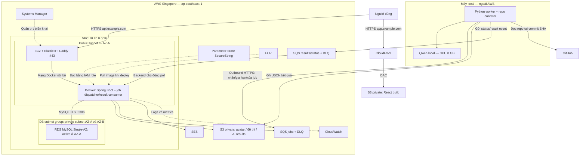

# FCAJ Hackathon — Tech stack, kiến trúc AWS và kế hoạch 5 tuần

Ngày: 19/10/2026. Trạng thái: đề xuất để nhóm review, chưa triển khai hoặc đo chi phí/tải.

Nguồn context: `E:/FA26/AWS/aws-modernization-plan.md` và source tại checkout hiện tại.
Checkout được kiểm tra: `main`, `f42a168`; commit `786aad2` ghi trong tài liệu context không phải HEAD của checkout này.

## 1. Mục tiêu và lựa chọn chính

- Nhóm 5 người, phần lớn đang học AWS foundation; thời gian khoảng 4–5 tuần.
- Giữ React + Spring Boot; triển khai backend bằng Docker trên một EC2.
- Đưa database lên RDS private, file lên S3, frontend lên CloudFront/S3.
- Điều phối AI local bằng SQS; không mở cổng inference trên máy cá nhân ra Internet.
- Đầu ra AI là gợi ý có dẫn chứng; giám khảo quyết định điểm chính thức.
- Inference local và tích hợp là đầu ra cốt lõi. Fine-tune là nhánh thí nghiệm có mốc đánh giá cuối tuần 1; cần xác nhận nếu mentor yêu cầu nó là điều kiện bắt buộc.
- Một AWS account làm integration/demo; account khác dùng học và thử nghiệm riêng. Kiểm tra credit và account plan thực tế trước khi dựng.
- Mục tiêu tự trả dưới 500.000 VND/tháng chưa đồng nghĩa toàn bộ stack có thể chạy 24/7 trong mức đó.

Tên đề tài gợi ý: **Modernizing a Hackathon Platform on AWS with a Local AI Judge Assistant**.

## 2. Tech stack đề xuất

| Lớp | Công nghệ | Phạm vi |
|---|---|---|
| Web | React 18, TypeScript, Vite | Giữ stack hiện tại, thêm UI AI job |
| API | Java 21, Spring Boot, Spring Security, JPA | Giữ baseline, bổ sung AWS integration và job API |
| AWS SDK | AWS SDK for Java v2 | S3, SQS, SES, Parameter Store; pin dependency BOM sau compatibility check |
| Database | RDS MySQL 8.4, Flyway | Kiểm tra tương thích với schema/JPA; migration riêng, runtime `ddl-auto=validate` |
| Compute | Ubuntu LTS x86_64, Docker Compose, EC2 | Compose chỉ chạy reverse proxy/API; MySQL ở RDS |
| HTTPS API | Caddy và chứng chỉ ACME | Terminate TLS tại EC2, forward về backend nội bộ |
| Frontend hosting | S3 private, CloudFront OAC | SPA rewrite chỉ áp dụng frontend |
| File storage | S3 private, AWS SDK | Avatar, problem statement, AI results tách bucket/prefix và policy |
| AI worker | Python, boto3, Pydantic | SQS consumer, repo collector, output validation |
| Local inference | llama.cpp/GGUF là ứng viên ban đầu | Chốt model, quantization và context sau benchmark GPU thực tế |
| Training | Transformers, PEFT/QLoRA, bitsandbytes | Thử môi trường CUDA phù hợp; inference GGUF và training checkpoint là hai artifact khác nhau |
| IaC | Terraform | Một công cụ chung; pin provider, state remote riêng và không commit state |
| CI/CD | GitHub Actions OIDC, ECR, SSM Run Command | Build image ngoài EC2, deploy image theo commit SHA |
| Testing | JUnit/Mockito, Vitest, pytest, k6 | Reuse test cũ, bổ sung test tích hợp và fault cases cần thiết |

Terraform được chọn cho kế hoạch này để tránh duy trì nhiều công cụ IaC. Nếu nhóm đã có kinh nghiệm CDK, thay lựa chọn này một lần trước khi triển khai.

## 3. Kiến trúc workshop v1

Region đề xuất: `ap-southeast-1`. Dùng tên miền nhóm sở hữu; `app.example.com` và `api.example.com` bên dưới chỉ là ví dụ.

Sơ đồ là bản thảo thảo luận do AI hỗ trợ, không phải sơ đồ AWS chuẩn để nộp. Nhóm tự review, quyết định và vẽ bản nghiệm thu bằng AWS Architecture Icons theo đúng tài nguyên đã chạy. Route 53 quản lý DNS; nó không phải proxy nằm trên đường dữ liệu HTTP. S3, SQS và CloudFront không đặt trong subnet của VPC.

### Network và HTTPS

- Public subnet có route `0.0.0.0/0` tới Internet Gateway; EC2 dùng Elastic IP cho endpoint API ổn định và outbound.
- EC2 Security Group mở 443; mở 80 chỉ để redirect HTTPS/ACME nếu dùng. Quản trị qua Session Manager; không mở 22.
- Backend 8080 không publish ra Internet; Caddy truy cập qua Docker network.
- Hai private DB subnet không có default route Internet/NAT; `PubliclyAccessible=false`.
- RDS Security Group chỉ cho 3306 từ EC2 Security Group; kết nối DB có TLS và xác minh server identity.
- Với một backend, bản v1 dùng Caddy làm HTTPS entry point. ALB và NAT không có trong bản triển khai này.
- EC2 vẫn là tài nguyên có public endpoint: phải trình bày rõ đánh đổi này, harden host và giới hạn điểm vào. Bản v1 không có HA ở tầng compute/database.
- CloudFront chỉ phục vụ frontend; API gọi thẳng `api.example.com`, không qua cache CloudFront.
- ACM cho custom domain CloudFront cấp tại `us-east-1`; API dùng chứng chỉ ACME do Caddy quản lý, không nhầm với ACM của CloudFront.
- Kiểm tra ownership/khả năng tạo DNS và điều kiện account trong ngày đầu. Nếu chưa có domain, không công bố auth/OAuth hoàn tất.

### Auth và storage

- Cookie auth: HttpOnly, Secure, SameSite phù hợp với hai hostname HTTPS cùng site; CORS chỉ cho frontend đã chốt và credentials.
- CSRF cookie cần scope domain để frontend đọc được; giữ auth cookie host-only khi có thể. Không đổi Domain sang miền không thuộc quyền nhóm.
- Forwarded headers phải phản ánh HTTPS public; cập nhật OAuth callback URL theo API domain.
- Một instance có thể giữ session OAuth tạm; khi nâng nhiều replica phải bổ sung shared session hoặc cơ chế state tương đương đã kiểm thử.
- S3 giữ Block Public Access. Frontend bucket chỉ được CloudFront OAC đọc; bucket dữ liệu không dùng policy public frontend.
- Đề thi được kiểm tra quyền và release/retract ở backend. Stream qua backend khi cần kiểm tra quyền từng lần; presigned URL ngắn hạn chỉ dùng khi chấp nhận URL còn hiệu lực tới lúc hết hạn.
- Chuyển file cũ và object key trước khi bỏ filesystem local; test redeploy không mất file.

## 4. Dịch vụ AWS và minh chứng

| Dịch vụ | Ứng dụng vào dự án | Minh chứng |
|---|---|---|
| VPC, Security Groups | Cách ly DB, giới hạn entry point | Không thể truy cập DB từ Internet; backend truy cập được |
| EC2, EBS | Chạy API bằng image version | Restart/redeploy và rollback có log |
| ECR | Image tag commit SHA, dùng digest khi deploy | Đối chiếu image đang chạy với commit |
| RDS | Dữ liệu nghiệp vụ, AI job/outbox | Restore sang DB thử nghiệm và xác minh |
| S3 | Frontend, persistent files, AI JSON | Thay container vẫn đọc file; truy cập sai quyền bị chặn |
| CloudFront | CDN/HTTPS frontend | Deep link React và asset caching đúng |
| SQS | Tách API khỏi thời gian chạy model local | Worker offline không làm request API treo |
| SES | OTP/approval email | Gửi tới địa chỉ demo đã verified; kiểm tra sandbox/quota |
| IAM, STS, OIDC | Tách quyền app, worker, pipeline | Negative test quyền ngoài phạm vi |
| Parameter Store | Đọc cấu hình nhạy cảm ngoài Git/image | Không có secret mặc định; thiếu cấu hình fail rõ |
| Systems Manager | Quản trị/deploy thay SSH | Deploy có audit với port 22 đóng |
| CloudWatch | Log, queue age, lỗi app, host metrics | Tìm một lỗi và kích hoạt một alarm thực tế |
| CloudTrail | Event history thao tác quản trị | Truy vết một thay đổi AWS, phân biệt với business audit log |
| AWS Budgets | Theo dõi dự toán/billing | Budget alert và cleanup checklist; alert không phải spending cap |

## 5. AI job và tích hợp

1. Judge yêu cầu phân tích submission đã được phân công; coordinator theo quyền hiện có.
2. Backend kiểm tra quyền, resolve commit SHA, lưu `AiAnalysisJob` và outbox trong cùng transaction.
3. Dispatcher gửi job tới SQS và đánh dấu outbox đã gửi. Crash có thể gửi lại; consumer phải idempotent.
4. Local worker long-poll SQS, báo STARTED qua result queue, đọc source tĩnh và gọi local inference.
5. Worker ghi JSON vào S3, gửi COMPLETED/FAILED event; chỉ xóa job message khi các bước ghi bền tương ứng đã thành công.
6. Backend nhận event, kiểm tra schema/điểm/evidence và job version, cập nhật DB rồi mới xóa result message.
7. Frontend lấy trạng thái qua API; chỉ người có quyền xem được kết quả. AI không tự ghi bảng Score.

Job tối thiểu: `jobId`, `analysisVersion`, `submissionId`, `repoUrl`, `commitSha`, `rubricVersion`, `schemaVersion`, `deadlineAt`.
Kết quả thêm: `modelId`, `modelRevision`, `adapterVersion`, `promptVersion`, evidence theo file/dòng, timing và mã lỗi.
Phải giữ cơ chế ẩn danh đang có khi hiển thị dữ liệu repository cho judge.

API gợi ý:

- `POST /api/ai/submissions/{id}/jobs`: trả `202` và job ID; có idempotency key cho double click.
- `GET /api/ai/jobs/{jobId}`: trạng thái, error code; kiểm tra assignment/ownership.
- `GET /api/ai/jobs/{jobId}/result`: kết quả đã validate và được phép xem.

State: `QUEUED -> RUNNING -> SUCCEEDED | FAILED | EXPIRED`. API polling có backoff khi tab nền; chưa cần WebSocket.

- Một worker, một inference đồng thời ở mốc đầu.
- SQS long polling 20 giây; cấu hình heartbeat gia hạn visibility trước khi hết hạn. Timeout tổng dựa trên benchmark tuần 1.
- Hai DLQ tách job/result; retry transport lỗi có giới hạn. Nội dung không hợp lệ được ghi lỗi rõ, không retry vô hạn.
- Result của analysisVersion cũ không được ghi đè version mới; duplicate terminal event không tạo kết quả/thông báo trùng.
- Worker kiểm tra deadline trước khi chạy. Backend reconciliation tìm outbox chưa gửi, job quá hạn và job bị DLQ.
- Bản đầu nhận public GitHub repo được cho phép; không thực thi dependency install/build/test hoặc script của repo.
- Repo collector giới hạn kích thước, file và token; loại dependency/generated/binary/secrets, không dùng nguyên repo làm prompt.
- Model candidate: Qwen2.5-Coder-7B-Instruct lượng tử hóa; chốt revision/license/runtime sau benchmark. Không cam kết fine-tune chạy được từ thông tin VRAM duy nhất.

## 6. Credentials và quyền

- EC2 dùng instance role. Container phải truy cập được IMDSv2 theo cấu hình host/container đã kiểm thử; không gắn long-term access key vào image.
- Local worker dùng identity riêng, temporary credentials; thử `aws login` với AWS CLI/SDK hỗ trợ hoặc phiên STS AssumeRole theo môi trường nhóm. Không dùng root để chạy worker; kiểm tra expiry trước demo.
- Worker chỉ receive/delete/change visibility trên jobs, send trên results, put đúng prefix AI result; không có quyền DB, deployment hoặc đọc đề thi.
- App chỉ truy cập bucket/prefix/queues và parameters cần thiết; tránh `AdministratorAccess` cho workload.
- GitHub Actions dùng OIDC trust giới hạn repository/ref/environment. Quyền Run Command giới hạn instance tag và document triển khai; quyền deploy là quyền nhạy cảm.
- SecureString được đọc lúc startup bằng IAM role; bootstrap admin được cấp riêng một lần, không sử dụng mật khẩu cố định trong source.
- Terraform state remote mã hóa, chặn public, có locking theo backend/provider đã pin. State có thể chứa dữ liệu nhạy cảm; không đưa secret value vào Terraform khi không cần.

## 7. Migration và CI/CD

- Tạo schema baseline từ entity hiện tại, đối chiếu trên MySQL 8.4 thử nghiệm; SQL snapshot cũ không mặc nhiên là baseline đúng.
- Với DB mới: chạy migration trước seed; với DB có dữ liệu: backup và thử upgrade/restore trước khi thay endpoint.
- Runtime `DDL_AUTO=validate`, `SEED_SCENARIO=NONE`; bootstrap tách khỏi demo seeder. App DB user không có quyền DDL; migrator dùng quyền riêng.
- GitHub Actions chạy JUnit/Vitest, build image, push ECR; SSM deploy script pull đúng digest, health check và rollback image nếu cần.
- Thêm readiness endpoint tối thiểu cho deploy; không công khai dữ liệu nhạy cảm từ management endpoints.
- Rollback image không tự rollback DB. Migration ưu tiên additive/backward-compatible; thay đổi phá vỡ cần quy trình phục hồi riêng.
- Frontend deploy riêng: build với API URL đúng, upload S3, cache asset có hash, cập nhật/invalidate HTML và kiểm thử SPA deep links.

## 8. Kế hoạch và phân công

| Tuần | Đầu ra bắt buộc | Owner chính | Nghiệm thu |
|---|---|---|---|
| 1 | Account/budget/domain; proposal; IAM/VPC lab; AI inference + thử train nhỏ; contract | Lead + tất cả | Chốt topology/cost inputs; một repo có output mẫu và số đo; schema job được review |
| 2 | EC2/ECR/RDS/S3/CloudFront; migration/secrets; một AI job xuyên suốt | BE1, BE2, FE, AI | Web -> queue -> local -> result hiển thị; không chờ fine-tune |
| 3 | CI/CD/rollback; SES; outbox/retry/DLQ; evaluation AI | BE1/BE2 + AI + Lead | Worker offline/duplicate message không làm hỏng state; pipeline chạy |
| 4 | Security tests; load/restore; IaC reproduce; cost; báo cáo/song ngữ/video | Tất cả | Người review tái dựng được; đủ bằng chứng kiến trúc/demo/cost |
| 5 | Buffer sửa lỗi, diễn tập cá nhân, cleanup | Tất cả | Demo ổn định và từng người giải thích được trade-off |

Lịch này tính tới ngày nộp workshop. Nếu mốc nhóm đang tính là ngày cần mộc thực tập, phải đưa hạn nộp trước 15 ngày theo hướng dẫn HCM vào lịch và giảm scope tương ứng.

Phân công tránh dồn mọi thứ vào BE2/AI:

- Lead: scope, architecture, IAM/network review, Terraform skeleton, billing/cost, integration và mentor.
- FE: CloudFront/S3 web, DNS/TLS frontend phối hợp Lead, auth browser, upload/download, UI AI job, workshop UI.
- BE1: RDS, Flyway, data migration, S3 storage abstraction, job API/outbox/result validation và backup/restore.
- BE2: EC2/ECR/SSM, CI/CD, SQS dispatcher/result consumer, SES và CloudWatch.
- AI: collector/model/dataset/evaluation; worker phối hợp BE2. BE1 hỗ trợ chuẩn hóa rubric/nhãn; không để AI tự quyết nhãn một mình.
- Mỗi phần có reviewer; worklog/blog/ảnh minh chứng làm xuyên suốt. Nếu tuần 2 chưa có luồng AI hoàn chỉnh, ưu tiên tích hợp và lỗi vận hành trước mở rộng training.

## 9. Chi phí và credit

Kế hoạch này chưa phải báo giá. Chưa kiểm tra account/credit thực tế; không gộp năm account thành một quỹ credit mặc định.

Sizing khởi đầu để đưa vào Calculator và benchmark, không phải cấu hình đã chứng minh chịu tải:

| Khoản | Cấu hình đầu vào | Lab có lịch chạy | Tháng 24/7 |
|---|---|---|---|
| EC2 | Một `t3.small` Linux x86_64, cân nhắc `t3.medium` nếu thiếu RAM | Ví dụ 120 instance-hours | 730 instance-hours |
| EBS | 20–30 GiB gp3, hạn chế images/logs trên host | Storage vẫn tính khi stop EC2 | GiB-month + snapshot nếu có |
| RDS | Single-AZ `db.t4g.micro`, 20 GiB gp3; kiểm tra availability/account | Ví dụ 120 DB-hours, cộng storage/backup cả kỳ | 730 DB-hours + storage/backup |
| Public IPv4 | Một Elastic IP | Giờ giữ IP, kể cả lúc EC2 dừng | 730 giờ |
| S3/CloudFront | GiB lưu trữ, request và GB transfer theo demo | Đo và điền | Đo và điền |
| SQS/SES | Long polls, job/result/retry và email | Đo và điền | Đo và điền |
| ECR/CloudWatch/config/DNS | Image GiB, log GiB, alarm/metrics và hosted zone | Có retention | Có retention |

Giá public IPv4 công bố là 0,005 USD/giờ: giữ một IP 730 giờ tương đương 3,65 USD trước credit/thuế. Dừng EC2 nhưng giữ Elastic IP không loại bỏ khoản này.

- Mỗi dòng cost sheet có đơn giá Singapore, ngày lấy giá, lượng sử dụng, trước credit, credit áp dụng và tiền tự trả; dùng AWS Pricing Calculator.
- Lịch 120 giờ chỉ giảm phần compute; EBS/RDS storage/IP/log retention vẫn có thể tính phí cả kỳ. Tính thêm CPU surplus credit nếu instance burstable chạy vượt baseline.
- Nếu dùng credit đủ điều kiện, tiền tự trả có thể giảm; xác nhận balance/expiry/service eligibility/Free hoặc Paid plan.
- Budget notification ở các ngưỡng do Lead chốt; đây không phải spending cap.
- Theo dõi actual billing; không cam kết stack EC2+RDS 24/7 dưới 500.000 VND khi chưa có estimate.
- Sau workshop: có thể giữ frontend/video và dựng backend/DB theo lịch bằng IaC; nếu yêu cầu backend 24/7, phải đổi ngân sách hoặc thiết kế sau khi có số đo.
- RDS stop tối đa 7 ngày rồi tự chạy lại; storage/backup không biến mất khi stop.
- Cleanup gồm EC2/EBS/EIP, RDS và snapshot, ECR, S3/object versions, logs/alarms, DNS và các tài nguyên có phí còn lại; giữ artifact cần nộp trước khi xóa.

## 10. Tiêu chí hoàn thành và phạm vi mở rộng

Core demo phải có:

1. Luồng event -> submission -> judge scoring -> kết quả trên AWS.
2. File còn sau redeploy; user sai track không tải được đề thi.
3. AI job thật tới local, commit/model/rubric có version, result đúng người được xem.
4. Worker offline, result trùng/sai schema, repo quá lớn và prompt injection có hành vi xác định.
5. Deploy/rollback, backup/restore, tìm log và alarm có bằng chứng.
6. Workshop song ngữ, cost sheet trước/sau credit, cleanup và đóng góp cá nhân.

Bản mở rộng tách riêng: ALB + ít nhất hai backend (EC2 Auto Scaling hoặc ECS Fargate), shared OAuth session, private app subnets với outbound phù hợp, RDS Multi-AZ. Chỉ đưa vào sơ đồ nghiệm thu sau khi đã triển khai và đo lại chi phí. Bản v1 một EC2 + Single-AZ RDS không được gọi là highly available.

## 11. Nguồn chính được đối chiếu

- [CloudFront OAC](https://docs.aws.amazon.com/AmazonCloudFront/latest/DeveloperGuide/private-content-restricting-access-to-s3.html)
- [RDS MySQL versions — chọn bản còn standard support](https://docs.aws.amazon.com/AmazonRDS/latest/UserGuide/MySQL.Concepts.VersionMgmt.html)
- [SQS long polling](https://docs.aws.amazon.com/AWSSimpleQueueService/latest/SQSDeveloperGuide/sqs-short-and-long-polling.html)
- [SQS visibility timeout](https://docs.aws.amazon.com/AWSSimpleQueueService/latest/SQSDeveloperGuide/sqs-visibility-timeout.html)
- [SQS at-least-once delivery](https://docs.aws.amazon.com/AWSSimpleQueueService/latest/SQSDeveloperGuide/standard-queues-at-least-once-delivery.html)
- [Parameter Store](https://docs.aws.amazon.com/systems-manager/latest/userguide/systems-manager-parameter-store.html)
- [Session Manager](https://docs.aws.amazon.com/systems-manager/latest/userguide/session-manager.html)
- [AWS CLI temporary login](https://docs.aws.amazon.com/cli/latest/userguide/cli-configure-sign-in.html)
- [GitHub Actions OIDC](https://docs.github.com/en/actions/how-tos/secure-your-work/security-harden-deployments/oidc-in-aws)
- [Public IPv4 pricing](https://aws.amazon.com/vpc/pricing/)
- [AWS account plans](https://docs.aws.amazon.com/awsaccountbilling/latest/aboutv2/free-tier-plans.html)
- [RDS stop/start](https://docs.aws.amazon.com/AmazonRDS/latest/UserGuide/USER_StopInstance.html)
- [AWS Pricing Calculator](https://calculator.aws/)
- [Qwen2.5-Coder-7B-Instruct](https://huggingface.co/Qwen/Qwen2.5-Coder-7B-Instruct)
- [PEFT quantization/QLoRA](https://huggingface.co/docs/peft/developer_guides/quantization)
- [FCAJ Workshop](https://hcm-rules.awsfcaj.com/3-project/)
- [FCAJ scoring](https://hcm-rules.awsfcaj.com/5-scoring/)
