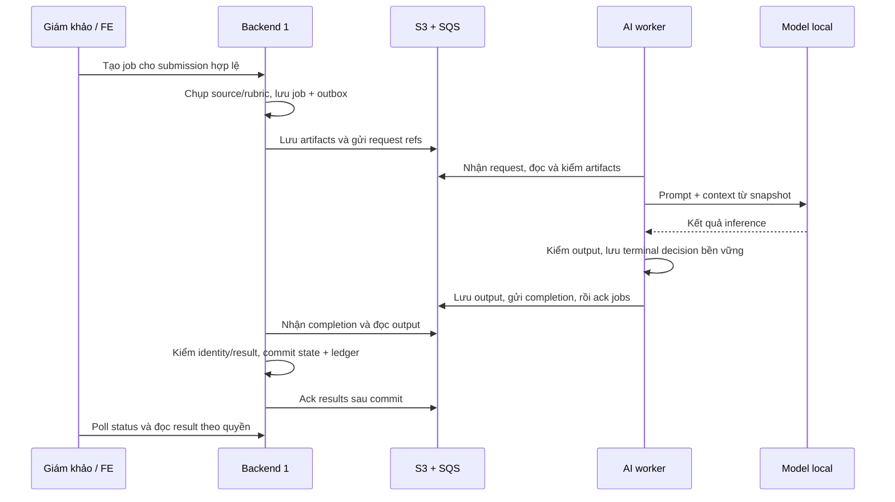

# Plan thảo luận và bàn giao BE1 ↔ AI Engineering

Ngày: 28/10/2026, Asia/Saigon. Trạng thái: **bản chuẩn bị thảo luận, chưa có xác nhận của AI Engineering/FE/BE2/Lead**.

Mục tiêu: thống nhất phần việc để đưa AI job từ worker MOCK sang model thật, xác định bộ bàn giao hai chiều, người phụ trách, phụ thuộc và tiêu chí nghiệm thu. Tài liệu này không ghi nhận việc đã họp, đã giao nhận hoặc đã nghiệm thu AWS. Các phương án và ngưỡng đề xuất dưới đây cần được ghi quyết định sau buổi trao đổi.

## 1. Kết quả cần có sau buổi thảo luận

Buổi làm việc cần kết thúc với sáu đầu ra cụ thể:

1. Chốt phạm vi bản model thật đầu tiên: loại phân tích, ngôn ngữ đầu ra, dữ liệu sử dụng, nội dung giám khảo được xem và việc có gợi ý điểm hay không.
2. Chỉ định người chịu trách nhiệm worker, inference adapter, prompt, benchmark, thay đổi backend và cấu hình AWS.
3. Review một bộ input/output/completion mẫu; ghi rõ phần dùng lại contract hiện hành và phần phải thay đổi/version hóa.
4. Chốt cách xử lý context model, timeout, retry, duplicate, worker offline và kết quả về muộn.
5. Có backlog theo thứ tự, người thực hiện/reviewer, dependency và thời hạn do từng bên xác nhận.
6. Chọn bộ bài kiểm chứng và tiêu chí đạt; đặt lịch review contract và lịch tích hợp sau khi kiểm tra mức sẵn sàng của AI Engineering.

Chưa có câu trả lời không được ghi thành đồng ý. Mục chưa chốt phải có owner trả lời và hạn phản hồi.

## 2. Nguồn hiện hành và điểm xuất phát

| Nguồn | Cách dùng |
|---|---|
| [Contract AI hiện hành](../contracts/ai-job-v1/CURRENT.md) | Chuẩn đang implement cho MOCK: HTTP, message, artifact, giới hạn và kiểm kết quả |
| [JSON hiện hành](../contracts/ai-job-v1/current-examples/) | Mẫu synthetic từ test producer → worker → consumer; không gửi vào queue nghiệp vụ |
| [Hướng dẫn BE1–BE2](backend1-be2-current-handoff-2026-10-28.md) | Source, module/package, migration và cách tích hợp hiện hành |
| [Đầu vào AWS còn cần](backend1-be2-aws-smoke-inputs-2026-10-28.md) | Prefix/provider/quyền/worker window và cấu hình queue cần BE2 xác nhận |
| [Bằng chứng local mới nhất](../checks/be1-be2-integration-2026-10-28/fresh-db-verification.md) | Giới hạn kết luận của kiểm thử local, MySQL và build image |
| [Phiếu review ngày 21/10](../proposals/ai-job-review-handoff.md) | Bối cảnh lịch sử; các state/API dự kiến trong đó không thay contract hiện hành |

Source tại lúc soạn: nhánh `feature/backend1-be2-handoff`, HEAD `bab44e5fdeb710e6c71982b2e8f5547829fa8e40`. Module `back-end/src/fcaj-api`, package `com.fcaj.hackathon`. Plan này là tài liệu bổ sung sau commit đó; không xem SHA này là revision chứa plan. Khi bàn giao, ghi lại revision của cả backend, worker, prompt và model/config thực tế.

### 2.1. Backend đã có gì

- Ba API: POST `/api/ai/submissions/{submissionId}/jobs`, GET `/api/ai/jobs/{jobId}`, GET `/api/ai/jobs/{jobId}/result`.
- Backend kiểm account/role/event/assignment/timer; requester lấy từ phiên. POST dùng JWT cookie vẫn cần CSRF.
- BE resolve public GitHub về commit SHA cố định, đọc source có giới hạn và lưu snapshot source/rubric/manifest bất biến.
- Ghi job + outbox trong DB; dispatcher gửi request SQS. Results consumer kiểm kết quả, commit state + ledger trước khi xóa message results.
- Worker Java `AwsMockWorkerMain` xử lý một message/lượt, tạo output giả để kiểm luồng; chưa chạy inference model thật.
- State hiện tại: `PENDING_DISPATCH`, `QUEUED`, `SUCCEEDED`, `FAILED`. Chưa có `RUNNING`, `EXPIRED`, heartbeat hoặc deadline xử lý thật.
- Quyền xem được kiểm lại mỗi request. Judge xem lịch sử do mình yêu cầu khi còn quyền; coordinator có grant đúng event. Đóng judging không tự xóa quyền đọc lịch sử; revoke/approval thay đổi có thể chặn lượt đọc tiếp.
- AI không ghi `Score`/`RoundResult`. POST chưa có HTTP idempotency key; FE không tự retry POST vì có thể tạo job mới.

### 2.2. Những ràng buộc MOCK phải sửa trước khi nhận model thật

| Ràng buộc hiện tại | Việc phải bàn và triển khai |
|---|---|
| Request/status/provenance chỉ dùng `MOCK` | Chọn mode và version cho model thật; BE cập nhật producer, persistence/DTO nếu cần và validator |
| Validator chỉ cho error `MOCK_PROCESSING_FAILED` | Thiết kế taxonomy lỗi model/worker, retryable hay terminal và safe code cho FE |
| `repo.analyzed` bắt buộc `false`; disclaimer cố định ghi MOCK | Chốt ý nghĩa mức phân tích source, cập nhật validator/mapper/disclaimer phù hợp |
| `suggestedScoreRange` bắt buộc `null` | Đề xuất mốc đầu giữ nhận xét; nếu muốn gợi ý điểm phải chốt cấu trúc/giới hạn/nghiệp vụ với Lead/FE |
| Evidence có trong output nội bộ nhưng bị loại khỏi DTO FE | Quyết định giám khảo có xem evidence không; nếu có, thiết kế DTO/UX/quyền và xử lý thông tin nhận diện |
| `deadlineAt=null`, chưa có STARTED/heartbeat/expiry | Chốt lifecycle trước khi thêm event/field/state; cần migration mới nếu thay persistence |
| MOCK output/message có thể tạo ổn định khi retry | Model thật có thể trả khác nhau: phải thiết kế lưu và tái sử dụng kết quả/terminal decision bền vững |
| Worker mock chưa strict validate toàn bộ source/rubric/manifest | AI worker cần validator đầu vào đầy đủ và test tương thích với BE |

**Không chỉ đổi tên model trong JSON rồi đưa vào queue đang dùng.** Backend hiện sẽ từ chối các giá trị trái contract MOCK. Giữ contract hiện hành để hồi quy; contract model thật phải được duyệt, implement ở cả hai phía và có kế hoạch chuyển phiên bản.

## 3. Phạm vi đề xuất cho lần tích hợp model thật đầu tiên

Đề xuất để review:

- Một worker, một job xử lý tại một thời điểm; bắt đầu từ một bài public repo nhỏ đã được cho phép dùng để test.
- Dùng đúng source/rubric snapshot do BE tạo. Worker không tự kéo HEAD mới, không tự đổi rubric hoặc lấy URL trong README để mở rộng dữ liệu.
- Đầu ra: tóm tắt, điểm mạnh, vấn đề cần kiểm tra và nhận xét từng tiêu chí; dẫn chứng trỏ tới snapshot. Khi thiếu dữ liệu phải nói rõ giới hạn.
- Giám khảo quyết định điểm. Tạm giữ `suggestedScoreRange=null` trong mốc đầu, chờ quyết định chung.
- Không clone/build/run code submission trong mốc đầu. Nếu AI cần test động, tách đề xuất môi trường thực thi, quyền, tài nguyên và acceptance riêng.
- Fine-tune, private repo, nhiều worker, phân tích demo/video và RAG chỉ đưa vào backlog sau khi xác nhận là yêu cầu; không tự trở thành điều kiện của mốc tích hợp đầu.

Đường đi đề xuất:

Phần inference/terminal decision của worker trong sơ đồ là thiết kế đề xuất, chưa có trong worker model thật. Cách lưu bền cần được chọn ở mục 6.5.

## 4. Bộ BE1 cần bàn giao cho AI Engineering

| ID | Deliverable | Nội dung và tiêu chí nhận | Trạng thái tại lúc soạn |
|---|---|---|---|
| BE-AI-01 | Revision và hướng dẫn source | Branch/SHA, module/package, Java21, file chạy local, vị trí validators và worker MOCK | Có trong bộ BE1; AI chưa xác nhận nhận |
| BE-AI-02 | Contract đang chạy | CURRENT.md + current-examples; phân biệt MOCK với phần model thật chưa có | Có; cần review chung |
| BE-AI-03 | Input đầy đủ | Request + manifest + source + rubric cùng một job; hash/size đúng bytes; mô tả field bắt buộc/nullable | Mẫu synthetic có; mẫu thực được phép dùng cần chọn |
| BE-AI-04 | Output/completion mẫu | Success và failure trên hai job riêng; identity echo, key/hash/version, field allowlist | MOCK có; model thật cần cùng thiết kế |
| BE-AI-05 | Bộ kiểm tương thích | Lệnh kiểm examples, test smoke producer/worker/consumer; các negative cases và expected reject | MOCK có; model thật cần bổ sung |
| BE-AI-06 | API/authorization cho FE | States, wrapper/errors, polling, quyền đọc sau đóng chấm/revoke, cách hiển thị mode | Có; FE/AI cần xác nhận |
| BE-AI-07 | Cấu hình worker và quyền cần thiết | Region/bucket/prefix/queues, provider role; worker không cần DB/JWT | Template có; prefix/provider/window chờ BE2 |
| BE-AI-08 | Test data và cách tái hiện | Submission/rubric/snapshot được phép chia sẻ, quyền tài khoản và timer cho API test, expected output | Cần chọn người chuẩn bị và bộ dữ liệu |

Các đường dẫn từ module backend cần chỉ cho AI:

- `src/main/java/com/fcaj/hackathon/aijob/AwsMockWorkerMain.java`: tham chiếu transport/ack; không phải inference implementation.
- `src/main/java/com/fcaj/hackathon/aijob/JobResultValidator.java`: kiểm completion/output và lọc DTO FE.
- `src/main/java/com/fcaj/hackathon/aijob/JobLimits.java`: giới hạn bytes dùng chung phía Java.
- `deploy/worker.env.example`: mẫu cấu hình không chứa secret.
- `Test/run-integration-smoke.ps1`: smoke local MOCK; không chứng minh model thật hoặc AWS đạt.

BE1 cần giải thích trực tiếp một job từ request tới completion. Chỉ gửi fixture rời không đủ để AI hiểu quan hệ hash/version/key.

## 5. Bộ AI Engineering cần bàn giao lại

| ID | Deliverable | Nội dung tối thiểu để BE nhận |
|---|---|---|
| AI-BE-01 | Hiện trạng AI | Đã chọn model/chạy inference/chưa có worker; repo/branch/SHA và demo khả năng hiện có |
| AI-BE-02 | Model/config manifest | Model ID + revision/hash weights, runtime/version, quantization, tokenizer/context, decoding parameters, license/điều kiện dùng đã kiểm, hardware/VRAM/RAM |
| AI-BE-03 | Prompt và inference adapter | Prompt có version, mapping rubric/context → model; code tách inference khỏi transport để test offline |
| AI-BE-04 | Context policy | Cách chọn/chunk/tóm tắt file, token budget, thứ tự xử lý, cách map evidence về file/dòng gốc và báo thiếu coverage |
| AI-BE-05 | JSON và lỗi thực tế | Ít nhất một success/failure từ inference thật, đúng contract dự kiến; mô tả lỗi JSON, model timeout/OOM và input không hỗ trợ |
| AI-BE-06 | Worker nếu AI nhận ownership | Mã nguồn + dependencies đã pin + lệnh chạy/test; validation input/output, visibility renewal, retry và durable completion theo thiết kế đã duyệt |
| AI-BE-07 | Báo cáo benchmark | Dataset IDs/hashes, config/hardware, thời gian đọc input/inference/validate/tổng, cold/warm, peak memory, số lượt và chất lượng |
| AI-BE-08 | Runbook | Khởi động/dừng/restart worker/model, readiness, log theo jobId, xử lý job kẹt/DLQ theo phối hợp, giới hạn đã biết |
| AI-BE-09 | Bộ đánh giá chất lượng | Nhận xét tham chiếu do người review, lỗi bịa/thiếu chứng cứ, kết quả theo tiêu chí, biên bản human review và đề xuất ngưỡng đạt |

Nếu worker do BE1 hoặc BE2 viết, AI-BE-06 chuyển sang người được chốt; AI vẫn chịu trách nhiệm adapter/model/context/output và kiểm chất lượng. Không mặc định AI chỉ giao endpoint, cũng không mặc định AI phải làm mọi phần AWS.

## 6. Các quyết định cần chốt trong buổi họp

### 6.1. Sản phẩm và chất lượng nhận xét

- Người dùng AI là judge/coordinator nào? Một yêu cầu phân tích được dùng để hỗ trợ quyết định gì?
- Nhận xét bằng tiếng Việt, tiếng Anh hay theo cấu hình? Chọn một ngôn ngữ cho bộ test đầu.
- Model chỉ nhận xét source tĩnh hay còn đánh giá demo/slide? Link có trong snapshot không đồng nghĩa worker được phép truy cập chúng.
- Criteria nào đánh giá được bằng source? Khi tiêu chí liên quan thuyết trình/UX mà không có dữ liệu, dùng thông báo thiếu dữ liệu hay cần field hỗ trợ riêng?
- Có gợi ý điểm không? Đề xuất mốc đầu chỉ nhận xét; mọi thay đổi điểm gợi ý cần Lead/FE duyệt và test theo maxScore/weight.
- Ai review chất lượng và có quyền quyết định output đủ dùng? Không dùng việc JSON hợp lệ làm bằng chứng nhận xét đúng.

### 6.2. Input snapshot, context và quyền dữ liệu

Giới hạn hiện hành để AI đánh giá khả năng xử lý:

| Thành phần | Giới hạn hiện tại |
|---|---|
| Queue message | 32,768 bytes |
| Manifest, rubric, output | Mỗi artifact tối đa 262,144 bytes |
| Source JSON | Tối đa 8,000,000 bytes |
| Collector | Tối đa 40 file, 100,000 bytes/file, 1,000,000 bytes text, 2,000 tree entries |
| Rubric | 1–50 criteria |
| Snapshot GitHub | Tổng budget 45 giây, tối đa 15 giây/request gồm body |

Các giới hạn bytes trên **không phải** số token/context model. 45 giây là budget thu thập snapshot, không phải timeout inference.

Cần chốt:

1. Model có thể nhận bao nhiêu token input và dành bao nhiêu cho output trên hardware thực?
2. Chọn file/chunk thế nào nếu input hợp lệ với BE nhưng vượt context? Cấm cắt ngầm rồi tuyên bố đã xem toàn bộ repo; chọn reject có safe code hoặc phân tích có mô tả coverage được contract hỗ trợ.
3. Nếu chunk/summarize, evidence vẫn trỏ về snapshot gốc với path và line range chính xác; không đổi line endings hoặc đánh lại số dòng mà không giữ mapping.
4. BE đã resolve SHA; worker không tự fetch repo mới. Nếu AI muốn bổ sung collector, ghi thành thay đổi kiến trúc riêng và tránh hai nguồn snapshot.
5. Manifest hiện có repo/demo/slide URL; source có thể có tên/email trong nội dung. Chốt dữ liệu nào được đưa vào prompt và dữ liệu nào phải lọc để hỗ trợ chấm ẩn danh. DTO lọc trường chưa đảm bảo toàn bộ nội dung ẩn danh.
6. Đề xuất inference local, không gửi source/output tới dịch vụ ngoài nếu chưa có quyết định nhóm về dữ liệu. Chốt nơi lưu raw prompt/output và retention; mặc định không ghi raw source vào log vận hành.

### 6.3. Output, evidence và contract version

- Mỗi criterion phải xuất hiện đúng một lần và khớp rubric snapshot. Evidence có path tồn tại, dòng bắt đầu/kết thúc hợp lệ; hiện tối đa 20 evidence/criterion và có thể rỗng. Chốt khi nào được rỗng vì không đủ dữ liệu.
- Validator kiểm vị trí tồn tại chưa chứng minh evidence hỗ trợ nhận xét. AI cần human review mức liên quan và các ca bịa dẫn chứng.
- Safe text hiện từ chối URL/email/NUL. Model dễ nhắc lại dữ liệu trong source: chốt cách xử lý trước validate và test việc lọc không bóp méo nội dung nhận xét.
- `modelId`, `modelRevision`, `adapterVersion` hiện giới hạn 100 ký tự và mẫu `[a-zA-Z0-9_.-]+`; tên model dạng đường dẫn có dấu `/` không thể đưa nguyên vào field. Chọn alias có mapping tới model manifest hoặc sửa contract có chủ đích.
- BE quyết định `processingVersion`, `modelConfigVersion`, `promptVersion` gửi đi; AI report cấu hình thực chạy. Chốt registry/mapping version để worker từ chối config không hỗ trợ. Echo identity đúng chưa chứng minh worker đã chạy đúng model/config.
- Evidence hiện không về FE, `repo.analyzed=false`, disclaimer là MOCK: phải sửa BE/FE trước khi tuyên bố có phân tích thật và hiển thị dẫn chứng.
- Chốt version cho request/source/manifest/output/completion và HTTP compatibility. Nếu thay semantics/field, không để worker cũ nhận nhầm; chọn queue riêng cho đợt test hoặc cơ chế routing/version đã được BE2 review.
- JSON Schema cho Python là deliverable đề xuất; phải test cả structural validation và semantic validation bằng chính validators/backend, không chỉ kiểm JSON parse.

### 6.4. Lifecycle, thời gian và lỗi

| Tình huống | Quyết định cần ghi |
|---|---|
| Worker offline | Giữ chờ đến khi nào; ai cảnh báo, khi nào người dùng được báo cần thử lại |
| Inference lâu | Timeout từng bước, tổng job deadline; giá trị lấy từ benchmark, không lấy timeout GitHub làm mẫu |
| Cần hiển thị đang chạy | Có thêm STARTED/RUNNING/startedAt không; ai phát event, BE cập nhật state và FE dùng thế nào |
| Quá hạn | Ai quyết định expiry; có EXPIRED hay safe failure; retry và late completion có được chấp nhận không |
| Đóng judging/revoke sau khi tạo | Có tiếp tục tính toán không; giữ quyền đọc theo policy hiện hành trừ khi Lead duyệt thay đổi; kết quả không mở lại quyền sửa điểm |
| JSON model sai | Có retry sinh/sửa JSON không, tối đa bao nhiêu lần, tính vào budget nào; không tự sửa nội dung thành nhận xét không còn căn cứ |
| OOM/input quá context | Retry cùng cấu hình có ích không; được giảm context hay phải fail rõ và báo coverage |
| S3/SQS/network lỗi | Retry transport theo backoff; không gán thành lỗi model; không ack khi bước bắt buộc chưa bền vững |
| Unknown version/checksum sai/input sai | Không chạy model; log mã lỗi an toàn, xử lý queue/DLQ theo quy ước được chốt |

Đề xuất phân loại lỗi để thảo luận: lỗi cấu hình/version; input không hợp lệ/không đủ dữ liệu; inference timeout/OOM; output không hợp lệ; lỗi transport. **Tên mã, HTTP mapping và retry policy chưa được chốt**; validator hiện chỉ nhận `MOCK_PROCESSING_FAILED`.

Nếu đổi schema/state, BE thêm migration mới và cập nhật gate/fingerprint theo quy trình; không sửa V1/V2/V3 đã phát hành. Nếu chưa cần RUNNING, FE phải có wording đúng như “đang chờ/xử lý”, không suy ra worker đã nhận chỉ từ QUEUED.

### 6.5. Retry, duplicate và kết quả không xác định

SQS có thể giao trùng. Với model thật, cùng input có thể tạo hai output khác nhau dù giữ prompt/config. Chỉ đặt temperature thấp không đủ thay cho idempotency.

Các điểm cần thiết kế trước code:

1. Khóa xử lý gồm jobId + inputRevision + processing/config versions; có bao nhiêu worker được claim và cơ chế ngăn hai inference đồng thời cùng job?
2. Chọn nơi lưu bền terminal decision của worker (output ref hoặc terminal failure, completion messageId/payload); không chỉ giữ trong RAM. Ai sở hữu store và cleanup/retention?
3. Khi output đã lưu mà completion chưa gửi, redelivery dùng lại đúng output và completion identity; không inference rồi ghi đè object bất biến.
4. Nếu worker chết sau khi tạo output nhưng trước khi lưu terminal record, xác định cách recover output hợp lệ và chọn một kết quả duy nhất. Cần conditional writes/claim hoặc thiết kế tương đương có test race; không coi “first writer wins” là đã implement chỉ bằng tên key cố định.
5. Completion đã gửi nhưng ack jobs thất bại: gửi lại cùng quyết định; consumer không đổi kết quả terminal đã chấp nhận. Hai completion khác nhau cho cùng job phải có policy conflict rõ ràng.
6. Failure terminal cũng cần ổn định: không để một lần redelivery tự chuyển failure thành success trái policy.
7. Không tự retry POST phía FE để giải quyết worker retry; đó là hai loại retry khác nhau và POST hiện tạo job mới.

Queue receive hiện override 120 giây, long poll 20 giây; outbox lease 300 giây là cơ chế DB riêng. Nếu inference có thể vượt 120 giây, AI/BE2 chốt gia hạn visibility, chu kỳ gia hạn, quyền `ChangeMessageVisibility`, xử lý gia hạn thất bại và shutdown. Tăng queue default riêng chưa đủ nếu client vẫn override 120 giây.

### 6.6. Model, hardware và vận hành

- AI trình bày model/runtime đã thử, hardware và kết quả đo; chưa chọn model thay AI chỉ từ proposal cũ.
- Chốt quantization, context, concurrency, seed/decoding, warm-up và model readiness. Health của backend hiện chỉ chứng minh DB readiness, không chứng minh worker/model online.
- Có cần worker Python + adapter gọi inference service local hay một process? Ai đóng gói dependencies, khởi động và giám sát từng phần?
- Chốt log fields: jobId, inputRevision/version, attempt, messageId, stage, elapsed time, safe error, memory nếu đo được; tránh log credentials/raw code/raw output.
- AI/BE2 chốt worker identity và phạm vi S3/SQS; không cấp DB/JWT cho worker. Quyền renew visibility phải được bổ sung nếu thiết kế dùng.
- Dừng/restart worker, hết phiên credentials và mất mạng cần có thao tác phục hồi được kiểm. Không mở public inference endpoint chỉ để backend gọi; luồng nền có thể tiếp tục qua SQS/S3.

## 7. Phân công đề xuất để xác nhận

| Phần việc | Owner đề xuất | Phối hợp / người review | Đầu ra |
|---|---|---|---|
| Quyền tạo/đọc, snapshot, API, persistence/outbox | BE1 | FE/Lead | API và dữ liệu đúng contract |
| Model/runtime/prompt/context policy | AI Engineering | BE1 + người review chất lượng | Adapter chạy offline, model manifest, benchmark |
| Worker SQS/S3 cho model thật | AI Engineering, cần xác nhận năng lực/phạm vi | BE1 review contract/idempotency; BE2 review IAM/runtime | Worker + runbook + tests |
| Contract mới và validator hai phía | BE1 + AI, mỗi bên giữ validator của mình | FE/BE2 review phần giao tiếp | Spec/samples/schema/compatibility tests |
| Queue/bucket/role/credential provider và log infrastructure | BE2 | AI/BE1 | Target/prefix/quyền/window được xác nhận |
| State/timeout/late result/retry | BE1 + AI thiết kế | BE2 vận hành, FE UX, Lead policy | Decision record + implementation tasks |
| Hiển thị insight/evidence/mode/errors | FE | BE1 + AI + Lead | DTO/UX đã duyệt |
| Chất lượng nhận xét và scope điểm gợi ý | AI + người review do Lead chỉ định | BE1/FE | Bộ đánh giá và ngưỡng đạt |

Ghi tên người thực hiện và reviewer cụ thể tại buổi họp. Mỗi task phải có một người chịu trách nhiệm chính, kể cả khi nhiều bên phối hợp.

## 8. Backlog sau khi có quyết định

| ID | Công việc | Dependency | Deliverable / điều kiện xong |
|---|---|---|---|
| AIJ-01 | Inventory mức sẵn sàng của AI | AI trình bày hiện trạng | Model/runtime/code/hardware hiện có, khoảng trống, owner và thời gian dự kiến |
| AIJ-02 | Freeze phạm vi và contract model thật | AIJ-01; quyết định mục 6 | Spec/version/mẫu success-failure và danh sách thay đổi BE/AI/FE được duyệt |
| AIJ-03 | Chọn dataset và benchmark offline | Input mẫu, rubric, hardware | Báo cáo latency/memory/quality; chọn budget và context policy bằng số đo |
| AIJ-04 | Inference adapter + validators | AIJ-02/03 | Chạy snapshot → output offline; negative cases đúng và có evidence mapping |
| AIJ-05 | BE hỗ trợ mode/version/lifecycle/errors/DTO | AIJ-02/03 | Producer/consumer/API/validator, migration mới nếu cần; giữ hồi quy MOCK |
| AIJ-06 | Worker transport + durable retry | AIJ-02/03/04; thiết kế mục 6.5 | Worker dùng output thật, có renew visibility nếu cần, recovery/duplicate tests |
| AIJ-07 | Kiểm tương thích hai implementation | AIJ-04/05/06 | Cùng bộ fixture được Python và Java chấp nhận/từ chối đúng; exact bytes/hash |
| AIJ-08 | Smoke S3/SQS trong môi trường đã chốt | AIJ-07 + inputs BE2 + window | Job thật → model thật → BE success/failure; evidence đã lọc; chưa bắt buộc EC2/RDS |
| AIJ-09 | FE và nghiệm thu ứng dụng triển khai | AIJ-08 + target EC2/RDS/FE sẵn sàng | Người dùng đúng quyền thấy result; revoke/wrong requester bị chặn, restart được kiểm |
| AIJ-10 | Chốt vận hành và handoff cuối | AIJ-09 + quality review đạt | Runbook, versions, owner trực, rollback và danh sách giới hạn được chấp nhận |

AIJ-03 có thể dùng input hiện hành để nghiên cứu trước khi freeze; kết quả bàn giao chính thức phải theo contract đã freeze. Chưa gán ngày hoặc số ngày cam kết khi chưa biết hiện trạng AI. Từng owner điền estimate và ngày hoàn thành sau AIJ-01; ưu tiên một luồng nhỏ chạy xuyên suốt trước khi tối ưu nhiều repo/model.

## 9. Mốc và tiêu chí nghiệm thu

### M1 — Chốt thiết kế và nhận bộ bàn giao

- Có tên owner/reviewer, decision record và deadline thực tế cho các mục bắt buộc.
- AI nhận được input mẫu đầy đủ; BE nhận được model/config manifest và kế hoạch worker.
- Các thay đổi so với MOCK được liệt kê; BE/AI/FE/BE2 biết phần mình phải sửa.

### M2 — Model thật chạy offline

- Snapshot cố định → inference → output JSON qua validator mới; kiểm đủ criteria và evidence trỏ đúng source.
- Có bài thành công, bài thiếu dữ liệu, input gần giới hạn và output sai để chứng minh cách xử lý.
- Có benchmark cold/warm; số lượt, kích thước input và percentile chỉ dùng khi số mẫu đủ ý nghĩa. Không lấy một lượt tốt nhất làm cam kết latency.
- Người review xác nhận chất lượng theo rubric; lưu đánh giá cả lỗi bịa nội dung/dẫn chứng và giới hạn coverage.

### M3 — Kết nối worker và backend

- Test tương thích đạt trước AWS; backend nhận mode/provenance/errors mới đúng thiết kế.
- Transport thật cần prefix/provider/queue pair/window từ BE2. Có thể dùng backend và DB lab local trước khi EC2/RDS sẵn sàng.
- Worker đọc input đúng hash/version, lưu output bất biến, gửi completion trước ack jobs; BE commit trước ack results.
- Duplicate/restart/crash recovery không tạo hai kết quả cuối hoặc ghi đè terminal; kết quả không đổi Score/RoundResult.

### M4 — Nghiệm thu để demo

- FE hiển thị đúng mode, trạng thái, giới hạn phân tích và errors; evidence chỉ hiển thị theo DTO/quyền đã chốt.
- Test account/assignment/revoke/wrong event được kiểm trên ứng dụng; model thật không làm lỏng guard hiện có.
- Có runbook, revision/config chính xác, log truy vết, người chạy worker và phương án khi worker offline.
- Model thật và transport được đánh dấu riêng với deploy EC2/RDS, browser OAuth/SMTP; chỉ ghi đạt phần có bằng chứng.

## 10. Ma trận kiểm thử tối thiểu để review

| Nhóm / ca | Kết quả mong đợi | Owner chuẩn bị |
|---|---|---|
| Input hợp lệ, repo nhỏ, rubric nhiều tiêu chí | Đủ tiêu chí, insight có căn cứ, BE nhận output | AI + BE1 |
| Tiêu chí không đủ thông tin trong source | Nêu thiếu dữ liệu; không suy đoán đã kiểm demo/thuyết trình | AI + reviewer |
| Input vượt context nhưng chưa vượt giới hạn BE | Theo policy reject/chunk/coverage đã chốt; không cắt ngầm | AI |
| Sai checksum/version/key/jobId/rubric/commit | Worker hoặc BE reject đúng ranh giới; không chạy/ghi result cho job khác | AI + BE1 |
| JSON thiếu/thừa field, duplicate keys, trailing JSON | Validator reject; policy retry JSON hữu hạn được kiểm | AI + BE1 |
| Sai evidence path/dòng hoặc criterion lặp/thiếu | Reject cấu trúc; human review bắt evidence không liên quan | AI + BE1 + reviewer |
| README/code chứa chỉ dẫn đổi rubric hoặc lộ danh tính | Xử lý như dữ liệu không tin cậy, không thực thi/chấp hành; đánh giá output/ẩn danh | AI + BE1 |
| OOM/timeout/model chưa ready | Safe error/retry theo policy, không lặp vô hạn | AI |
| Inference vượt visibility ban đầu | Renew hoạt động; kiểm cả renew failure và mất quyền | AI + BE2 |
| Output đã lưu, gửi completion lỗi rồi restart | Dùng lại đúng terminal decision/output, không ghi đè | AI |
| Completion đã gửi, ack jobs lỗi | Redelivery không tạo kết quả khác; BE dedup đúng | AI + BE1 |
| Hai worker/attempt cạnh tranh | Claim/conflict theo thiết kế, chỉ một kết quả cuối được chấp nhận | AI + BE1 |
| DB commit thất bại trước ack results | Message không bị xóa; retry không mất kết quả | BE1 |
| Worker offline/quá hạn/kết quả về muộn | Đúng deadline và state policy đã duyệt | AI + BE1 + FE |
| Judge khác/revoke/account không hợp lệ | Không đọc được result; output không đổi quyền truy cập | BE1 + FE |
| Restart model/worker/backend | Dữ liệu và terminal state giữ đúng; có evidence restart process thật | AI + BE1 + BE2 |

Đề xuất bộ chất lượng ban đầu: 5–10 snapshot được phép dùng, gồm ít nhất một bài thiếu dữ liệu, một bài lớn gần context và một bài có chỉ dẫn gây nhiễu trong README. Đây là bộ smoke chất lượng ban đầu, chưa đủ chứng minh khả năng tổng quát hoặc độ tin cậy giữa giám khảo.

Trước khi nghiệm thu, điền các ngưỡng sau bằng số đo và quyết định nhóm:

| Chỉ số | Ngưỡng / phương pháp cần chốt | Người chốt |
|---|---|---|
| Tỷ lệ output hợp lệ sau số lần retry cho phép | Chưa chốt; ghi cả trước/sau retry | AI + BE1 |
| Evidence đúng vị trí và hỗ trợ nhận xét | Vị trí hợp lệ 100% trên ca success; mức liên quan do reviewer chấm theo phiếu được duyệt | AI + reviewer |
| Bịa nhận xét hoặc khẳng định vượt dữ liệu | Định nghĩa lỗi nghiêm trọng, ngưỡng chấp nhận và cách xử lý | Lead + reviewer |
| Latency tổng/cold/warm và peak memory | Chốt trên hardware/dataset/config ghi rõ; deadline dựa số đo | AI + BE2 + BE1 |
| Mức bao phủ tiêu chí/context | Không thiếu criterion; cách ghi thiếu dữ liệu/coverage được duyệt | AI + BE1 + FE |

## 11. Agenda đề xuất cho buổi trao đổi 75 phút

| Thời lượng | Nội dung | Đầu ra |
|---|---|---|
| 0–10 phút | AI trình bày hiện trạng model/runtime/worker; BE mô tả luồng hiện có | Biết việc nào đã có, việc nào cần làm |
| 10–25 phút | Cùng đọc một request, source/rubric và output/completion | Thống nhất dữ liệu, refs/hash/version và khoảng trống contract |
| 25–40 phút | Chốt scope nhận xét, context, evidence, điểm gợi ý và dữ liệu ẩn danh | Quyết định sản phẩm/input/output |
| 40–55 phút | Worker ownership, benchmark, timeout/visibility, retry/duplicate/recovery | Thiết kế vận hành và task cần BE2 |
| 55–65 phút | Dataset/chất lượng, test matrix và các mốc M1–M4 | Tiêu chí nghiệm thu và người review |
| 65–75 phút | Điền owner/reviewer/estimate/deadline, đọc lại quyết định | Backlog có người nhận và lịch review tiếp |

Nếu thời gian không đủ, ưu tiên scope, ownership, contract và input benchmark; các quyết định ảnh hưởng code chưa chốt phải giữ pending và hẹn buổi xử lý cụ thể.

## 12. Biên bản để điền sau cuộc họp

Ngày/giờ họp: chưa có. Người tham dự: chưa có. Link phản hồi/biên bản: chưa có.

| ID | Quyết định | Đề xuất ban đầu | Quyết định thực tế / người xác nhận / bằng chứng | Hạn phản hồi | Trạng thái |
|---|---|---|---|---|---|
| D01 | Phạm vi phân tích/ngôn ngữ/điểm gợi ý | Source tĩnh, nhận xét, chưa gợi ý điểm | Chưa có | Chưa chốt | Pending |
| D02 | Worker owner/runtime/repo | AI phụ trách worker, BE1/BE2 review boundary | Chưa có | Chưa chốt | Pending |
| D03 | Model/config/hardware và prompt owner | AI đề xuất bằng kết quả chạy thực tế | Chưa có | Chưa chốt | Pending |
| D04 | Context budget/chunk/coverage | Dùng snapshot BE; xử lý vượt context minh bạch | Chưa có | Chưa chốt | Pending |
| D05 | Contract/mode/version/errors | Version hóa rõ, giữ hồi quy MOCK | Chưa có | Chưa chốt | Pending |
| D06 | Evidence và DTO FE | Review việc hiển thị; nội bộ hiện đã kiểm path/dòng | Chưa có | Chưa chốt | Pending |
| D07 | State/deadline/late result/JSON retry | Chốt sau benchmark; không tự thêm RUNNING/EXPIRED | Chưa có | Chưa chốt | Pending |
| D08 | Durable terminal decision/duplicate/claim | Thiết kế worker recovery trước test AWS | Chưa có | Chưa chốt | Pending |
| D09 | Visibility/IAM/prefix/provider/window | AI + BE2 xác nhận, không đoán scope | Chưa có | Chưa chốt | Pending |
| D10 | Dataset/ngưỡng chất lượng/reviewer | Bộ smoke 5–10 snapshot, human review riêng | Chưa có | Chưa chốt | Pending |
| D11 | Data sharing/retention/raw logs | Inference local, lọc nhận diện theo policy đã duyệt | Chưa có | Chưa chốt | Pending |
| D12 | Ngày bàn giao và lịch M1–M4 | Owner ước lượng sau inventory AIJ-01 | Chưa có | Chưa chốt | Pending |

Phiếu giao nhận:

| Bộ | Người giao → người nhận | Revision/link | Ngày nhận và phản hồi | Trạng thái |
|---|---|---|---|---|
| BE-AI-01…08 | BE1 → AI | Chưa điền revision bàn giao cuối | Chưa có | Chưa xác nhận nhận |
| AI-BE-01…09 | AI → BE1 | Chưa có | Chưa có | Chưa bàn giao |
| IAM/runtime/queue window | BE2 → BE1 + AI | Theo handoff BE2, cần xác nhận phần còn thiếu | Chưa có | Một phần đã có nguồn, chưa kiểm live |
| DTO/UX và policy | BE1 + AI → FE/Lead review | Chưa có bản model thật | Chưa có | Chờ review |

Sau họp: cập nhật quyết định có bằng chứng, tách implementation tasks, ghi dependency/owner/deadline; chỉ cập nhật contract hiện hành sau khi thiết kế được duyệt và implementation/test tương ứng sẵn sàng. Không sửa báo cáo kiểm thử cũ thành bằng chứng cho model thật.
